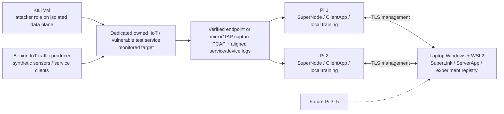

# Isolated Kali / IIoT / Flower deployment plan

**Design only.** No scanning, attacks, vulnerable services, interface changes,
firewall changes or Internet-facing targets are started by this document or its
companion code. Deployment requires a separately authorized physical session.

## Roles and logical topology

An IoT producer generates normal telemetry; a monitored target hosts the service;
an attacker generates the authorized scenario; a capture node observes an
explicit interface/TAP; an FL client trains a model on labelled local rows.
These roles may share a device only when visibility, resource contention and
isolation are documented. **An IoT node is not automatically an FL client.**
Kali does not provide trusted labels by itself; orchestration and target evidence
establish what actually happened.

## Addressing and separation (proposed, not configured)

Reserve distinct dedicated management and experiment segments, e.g.
`10.77.10.0/24` for authenticated Flower management and `10.77.20.0/24` for
laboratory traffic, **only after checking for conflicts with the actual LAN/VPN**.
Example host assignments:

| Role | Management address | Experiment address |
|---|---|---|
| Laptop/WSL reachable endpoint | .10 | No attack-plane endpoint unless explicitly designed |
| Pi 1 / Pi 2 | .21 / .22 | .21 / .22 only if target/producer role also assigned |
| Future Pi 3–5 | .23–.25 | Role dependent |
| Kali VM | No direct Flower management access | 10.77.20.50 |
| Dedicated target service | Controlled admin access | 10.77.20.60 |
| Capture/TAP monitor | Controlled management only | Passive observation where feasible |

No default route from the attack segment to campus/home/Internet, no automatic
dual-homed forwarding, and no public/bridged vulnerable VM are assumed. The
management endpoint must be reachable from the Pis through a deliberately
scoped WSL2 arrangement; Windows localhost behavior does not prove LAN access.
TLS SANs must match the chosen real endpoint. Do not disable host firewalls to
make connectivity work. These example addresses are not commands to configure.

## Inventory and purchasing checklist

- Initially two 64-bit Raspberry Pi devices, with documented RAM/CPU model;
  expand to 3–5 only after two-node reproducibility works.
- Correct official-quality power supplies, cooling/enclosures, storage and spare
  media; verify interface/power requirements for the selected model before buying.
- Dedicated Ethernet switch, labelled cables and isolated target/IoT service
  host(s). Use a mirror-capable switch or TAP if observation of other endpoints'
  traffic is required; promiscuous mode on an ordinary switched port is not enough.
- Laptop capacity for WSL2, Kali VM and simultaneous coordinator/capture/logging;
  separate management/data interfaces or a validated equivalent isolation design.
- Optional power meter for energy claims, clock synchronization source and secure
  credential storage. No energy claim without measurement equipment.

No model-specific prices, stock or device performance are asserted. Record the
actual inventory/versions and snapshots after purchase.

## Manual rollout and isolation checks

Before any scenario: document network adapters/routes, disable unintended
forwarding through the approved procedure, verify that the lab segment has no
unapproved egress, and verify all target addresses against the owned inventory.
Use benign local connectivity/capture checks first. Confirm timestamps, capture
drops, service log access and extractor parity. Verify TLS trust rejection and
registered-node identity on the actual devices. Save topology screenshots,
configuration exports and signed experiment labels with credentials redacted.
Stop if isolation or target ownership is uncertain. No automatic network-setup
or attack script is included in the pre-Pi software package.

## Controlled scenario catalogue

| Scenario | Intended lab scope | Required evidence / exclusions |
|---|---|---|
| Benign IoT telemetry | Owned sensors/producers and target services | Repeated independent normal sessions and workload variation |
| Reconnaissance | Owned isolated address/service inventory only | Exact approved target list and bounded schedule; no external scans |
| DoS | Dedicated disposable lab service | Rate/duration/resource limits agreed before run; stop criteria |
| Brute force | Synthetic credentials on disposable service | No real user accounts, credential theft or reused production passwords |
| Web cases | Dedicated intentionally vulnerable test service | Synthetic records; no Internet exposure; map exact attack subtype only with evidence |
| Multi-source DDoS | Only if multiple isolated, authorized sources exist | One Kali VM is not automatically a distributed attack; otherwise mark not implemented |

Do not label all unsuccessful attempts as successful target compromise. Record
intended action, actual execution evidence, observed target effect and ambiguity.
Novel cases outside the 84-class mapping remain unmapped/unknown until a new
taxonomy/version is approved; they are not forced into the nearest label.

## Ground-truth and session schema

Each capture manifest should include `experiment_id`, `session_id`,
`capture_id`, `client_id`, attacker/producer/target/capture roles, device/OS,
UTC boundaries, clock offsets, scenario ID, intended subtype, family, label
evidence, actual effect, ambiguity flag, reset/cooldown, PCAP/log hashes, capture
drop counts and feature-extractor/schema version. Scenario labels come from
orchestration plus target/service evidence, never model predictions.

Separate **training**, **development/validation** and **final evaluation** physical
sessions with fresh PCAP/log files, IDs, starts/stops and appropriate resets.
Keep every session's related five-second windows in one split, exclude transitions
by a prespecified rule, and collect independent benign sessions. The old heuristic
episode IDs do not become physical-session evidence. Keep evaluation sessions
locked out of gradients, weighting, resampling, tuning and continuation updates.

## Before/after learning and HCM protocol

1. Evaluate a frozen dataset-trained checkpoint on the newly labelled held-out
   sessions to measure domain shift; report class coverage and unsupported labels.
2. Train matched local-only models on each node's new training sessions. Train
   FedAvg from the declared same initialization/checkpoint with measured sample
   counts and documented optimizer/round budget. A pooled centralized reference
   is optional only if its raw-data pooling is permitted.
3. Define client-relative A/B/C unseen subsets from **new training support** only.
   Compare all models on identical evaluation rows and export class/support counts.
4. New independent labels can enter a new training-data version and explicit FL
   continuation run. Record checkpoint lineage, whether data are new-only or
   cumulative/replay-mixed, and avoid double-counting rows in aggregation weights.
   An evaluation session used to decide adaptation cannot remain an untouched
   final evaluation for confirmatory claims; obtain fresh sessions as needed.
5. Apply Detection/Family/Subtype metrics, per-class precision/recall/F1, benign
   FPR, five sample error categories and the same formal Riehl HCM conventions.
   Retain exact flat confusion matrices and zero-support disclosures. Analyze
   repeated independent sessions separately from seed variability.

Offline replay of old/synthetic PCAP validates engineering only; genuinely new
traffic requires actual capture/session ground truth. Replaying a trace does
not create a new independent attack session. Physical communication, inference,
training, memory and energy measurements require their own instrumented logs.

This plan and [the readiness package](pi_deployment_readiness.md) are CS402 rollout
inputs, not completed hardware experiments.
