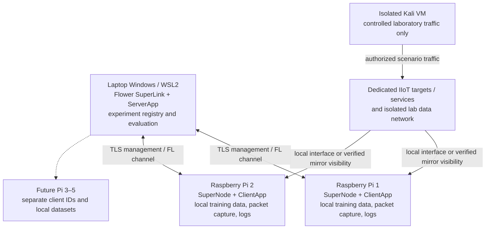

# Future physical Flower / Raspberry Pi / Kali IIoT laboratory

Status: **design only, 2026-10-25**. No devices, VM networking, firewall rules,
traffic capture, attacks or live federated rounds were configured or started by
this task. The existing five-client Flower/Ray experiments are simulations. The
old Pi-labelled inference log has limited device/protocol provenance and does
not demonstrate physical federated learning.

## Research objective and topology

Test the proposal's question: can collaboration improve recognition of attacks
absent from one client's training sessions but observed by other clients?
Begin with two physical Raspberry Pi clients and expand to three–five after
feature parity and independent-session evaluation work. Keep a dataset-based
simulation reference arm; physical measurements form separate experiments.

The diagram describes logical roles, not existing interfaces or verified packet
visibility. A Pi acting as an endpoint sees its own traffic; promiscuous mode
alone on a switched LAN does not provide all other endpoints' packets. Decide
between endpoint capture, a dedicated mirror/TAP, or an instrumented gateway;
verify capture completeness with controlled benign traffic before experiments.
Kali is a traffic-generation node, not an FL client or a source of model labels.

## Isolation and WSL2 reachability

Use a dedicated physical switch/lab network and an isolated VM attachment for
Kali. Keep the experiment data plane separate from the Flower management plane
and ordinary home/campus/production networks. No internet gateway or forwarding
from the attack network is part of the design. Maintenance access, if needed,
must be a separately controlled phase; do not assume a dual-homed laptop is
isolated automatically. Preserve an explicit topology, allowed endpoints,
address plan, interface inventory and reachability evidence for every run.

WSL2's normal localhost access from Windows does not establish that Raspberry
Pis can reach a WSL2-hosted server. During a future deployment, inspect Windows,
WSL and VM versions and choose a documented lab-only route: a supported mirrored
mode with scoped firewall permissions, or restricted NAT forwarding to the
SuperLink endpoint. Certificate names must match the actual reachable endpoint.
Do not open all host interfaces or disable the firewall to solve reachability.
This design changes no WSL, hypervisor or network settings. Microsoft documents
the distinction between NAT, LAN access and mirrored networking in
[WSL networking](https://learn.microsoft.com/en-us/windows/wsl/networking).

## Flower processes, version and security contract

The laptop WSL2 environment hosts the long-running SuperLink and the experiment's
ServerApp. Each Pi runs a SuperNode and executes its own ClientApp against a
local data path. SuperNodes initiate the Fleet connection to SuperLink; an
external actor should not need unrestricted access to each Pi's Runtime API.
Keep Runtime/API processes locally scoped, and expose only the planned
management endpoint to approved Pi addresses. Verify deployment flags against
the selected pinned version; current online docs can describe a newer version
than this project's **Flower 1.40.0**.

Use TLS with a lab CA, correctly scoped SANs, hostname verification and separate
credentials for each node. Register/allow only intended nodes using the selected
Flower version's supported authentication workflow. Protect private keys outside
shared artifacts; save certificate fingerprints and expiry metadata rather
than secrets. Server-authenticated TLS and node-signature authentication are
different from mutually authenticated TLS; do not claim mTLS without implementing
and verifying it. Require an authentication-negative check before training.
Do not reuse the simulation's plaintext `--insecure` configuration for physical
deployment.

The official references are [Flower network communication](https://flower.ai/docs/framework/main/en/ref-flower-network-communication.html),
[TLS](https://flower.ai/docs/framework/how-to-enable-tls-connections.html) and
[SuperNode authentication](https://flower.ai/docs/framework/how-to-authenticate-supernodes.html).
The network reference describes the shared HTTP APIs and outgoing SuperNode
connections; validate concrete ports and flags for the pinned runtime before
use. No certificates, keys, firewall rules or services are created by this
document.

## Application changes needed before a physical run

The existing `flower_subtype_app/` is a fixed **five simulated partitions**
experiment: it uses simulation `partition-id`, fixed sample sizes, requires all
five replies and transmits a WSL project-root path. It cannot be deployed to two
Pis unchanged. Create a new versioned deployment app, preserving both existing
Flower apps and every historical output. That future app must:

- Resolve client data through node-local configuration, never a laptop absolute
  path; use stable client IDs independent of current simulation partition IDs.
- Support a declared federation size of two, then three–five, and define minimum
  participation, timeout, failure handling and duplicate-client checks.
- Enforce the same global 84-class order, 71-feature order, preprocessing,
  architecture and taxonomy hash on server and clients before every round.
- Use true eligible local training counts for sample-weighted aggregation;
  report sample counts, class supports, participation and local optimizer policy.
- Pin compatible Python/Flower/PyTorch builds on ARM and x86. Verify ARM package
  availability and run checkpoint/golden-window inference parity; do not assume
  CPU timings or numerical reproducibility match WSL.
- Store local raw captures/logs and training rows locally; send model updates
  and the documented metrics. FL and TLS alone do not guarantee protection
  against information leakage from updates; secure aggregation or differential
  privacy would be separate evaluated extensions.

## Local capture and five-second feature contract

The project currently consumes precomputed sample CSVs. The inspected training
code does **not** establish an equivalent live packet/log feature extractor.
Capture→feature parity is a prerequisite, not a completed capability. Keep
versioned raw PCAP/PCAPNG files and synchronized application/device logs, their
hashes, capture interface, timestamp precision, packet drops and extractor
version. Perform approved captures locally with a predefined retention policy.

Use five-second windows with a written contract covering window origin,
half-open boundaries, clock/timezone, grouping key, directional conventions,
protocol handling, units, missing values, empty windows, standard-deviation
definition and aggregation of multiple flows/devices. Document late packets,
clock drift, restarts, overlapping scenarios and startup/cooldown gaps. Source
dataset window semantics must be recovered from authoritative extraction
documentation before claiming compatibility.

The frozen checkpoint schema lists **71 features: 64 `network_` and 7 `log_`**.
The complete ordered checklist is in
[the feature parity inventory](../results/formal_hcm_v1/future_testbed_feature_parity_inventory.csv)
and the authoritative saved names/order are in
[schema.json](../flower_subtype_app/seniorfl_subtype/schema.json).

| Feature group | Planned evidence source | Required parity questions |
|---|---|---|
| Packet/header/payload length aggregates | Packet capture plus specified parser | Link/IP/transport boundaries, fragmentation, truncation, units |
| Packet counts and intervals | Timestamped capture, direction/group rules | All/src/dst meanings, duplicate/retransmission handling, interval semantics |
| TCP flags, IP flags, window, MSS | Decoded protocol fields | Bit/flag counting conventions, options, absent protocol values |
| IP/MAC/port/protocol counts | Windowed distinct-value sets | Uniqueness rules, endpoint direction, VLAN/encapsulation handling |
| Fragmentation score/fragment counts | Capture plus dataset-specific definitions | Exact score formula and reassembly assumptions; not guessed |
| `log_messages_count`, `log_interval-messages` | Instrumented IIoT application/device logs | Message definition, timestamps, synchronization and grouping |
| `log_data-types_count` | Structured application/device telemetry | Type system, parsing and distinct-type counting |
| Four `log_data-ranges_*` aggregates | Structured application/device telemetry | Range definition, numeric values, aggregation and std convention |

Encrypted traffic or packet capture alone may not expose the information needed
for application/log features. Instrument the relevant IIoT service/device, or
establish an authoritative equivalent source. **Do not fill seven unavailable
log features with zeros and claim the original model is comparable.** If
faithful recovery is infeasible, create a separately named network-only model
and dataset experiment, retrain its baselines and report the changed feature
space; preserve the 71-feature reference experiment.

For parity acceptance, prepare labelled golden windows with independently
checked raw measurements and authoritative expected feature values. Compare
all 71 raw features with declared numerical tolerances, then check identical
feature ordering and the model's transformation: float64, NaN/±Inf→0, clip
±1e8, signed log1p, float32. Compare predictions on Pi and WSL for the same
serialized windows and checkpoint. Finiteness and correct tensor shape alone
are insufficient evidence of semantic parity. No numerical parity tolerance or
successful parity result is claimed before that study is conducted.

## Labels and independent sessions

Assign unique experiment, capture-session, client, target-device and scenario
IDs. Record UTC start/stop times, intended attack subtype, service state, actual
execution evidence and benign background workload in an orchestration manifest.
The analyst derives ground truth from scenario evidence, never from the model's
own predictions. Distinguish an attempted attack from a verified effect; mark
uncertain, mixed or transitional windows as ambiguous under a prespecified rule.
Treat unknown/unmapped traffic explicitly instead of forcing it into an 84-class
label. The frozen subtype→family mapping must remain unambiguous.

Collect training, development/validation and final evaluation in **separate
physical runs**, with fresh capture files and session IDs. Keep complete sessions
together, use planned cooldown intervals and record device/service resets where
appropriate. Do not split adjacent windows of the same scenario randomly across
training and evaluation. Include independent benign sessions, not only attack
windows. Verify session/capture hashes and temporal intersections before fitting.
These verified physical session IDs would be new evidence; the old dataset's
heuristic episode IDs do not become independent ground truth retroactively.

Use an independent development pool for tuning and keep the final session pool
locked until the planned comparison. Match exact evaluation rows and label
coverage across compared models. Declare absent classes and uncertain labels;
two clients do not imply coverage of all 83 attack subtypes.

## Local-only, federated and transfer comparisons

Prespecify the experiment arms: each client's local-only model, the shared
FedAvg model, and a centralized pooled-training reference only if pooling is
permitted by the lab protocol. Use matched architecture, feature extractor,
taxonomy, initialization/seed policy, training sessions, evaluation sessions
and recorded computation/data-exposure budgets. Explain persistent versus
reset optimizer states rather than claiming rounds and centralized epochs are
equivalent. Evaluate an unchanged dataset-trained model separately from a model
adapted on the new laboratory training data to expose domain shift.

Start with a two-client Non-IID scenario in which each has documented training
support. For a locally unseen subtype/family, verify absence in that client's
training and presence at another participating client; evaluate all arms on the
same fixed session subset. Report supports, empty subsets and overlapping
client-relative masks. Expand to three–five physical nodes, repeated seeds and
controlled class-imbalance interventions after the initial comparisons work.
Do not treat correlated five-second windows as independent session replicates.

Report detection recall/precision, benign false-positive rate, family/subtype
accuracy, per-class precision/recall/F1, observed-label and zero-support-inclusive
Macro F1 with explicit label sets, and confusion matrices. Include the five
sample error categories as diagnostics and **formal Riehl HCM separately**, using
the pinned code-compatible TN semantics, unpadded Benign branch, complete frozen
taxonomy and micro aggregation. Retain flat metrics and HCM TP/TN/FP/FN counts;
HCM specificity is not the benign operational false-positive rate.

## How new labelled data enables additional FL rounds

Unlabelled capture supports inference and drift monitoring, but does not supply
targets for the existing supervised cross-entropy training loop. After a new
training session is independently labelled, quality-checked and accepted into
a **new immutable client-local training version**, that node can train from a
declared existing global checkpoint. The server starts an explicitly named
continuation run, distributes common weights/schema, receives local updates,
and aggregates them using eligible training counts. Record whether data are
cumulative, new-only or replay-mixed and avoid accidental double weighting of
the same rows. Save the checkpoint lineage and optimizer reset/resume policy.

Never add final evaluation-session records to that training version while still
reporting them as independent evaluation of the continued model. Acquire fresh
evaluation sessions after a protocol change if the old evaluation set influenced
training decisions. Evaluate the adapted model against the frozen pre-adaptation
model and local-only arms. New labels outside the existing 84 classes require a
new versioned taxonomy/head and new compatible baselines; an unseen label cannot
be trained into the unchanged output head without an explicit mapping decision.
Do not claim adaptation gains until measurements exist.

## Experiment artifacts and rollout gates

Use new result/model/data directories for every physical experiment. Preserve
exact commands, source snapshots, dependency locks/freezes, schema hashes,
topology and isolation diagrams, ARM/x86 hardware/OS/runtime versions, seeds,
session manifest, label decisions, clock checks, capture/log hashes, extractor
parity reports, initial/final weights and lineage, round/client sample counts,
participation/failure logs, metrics, predictions, count/normalized matrices and
PNG/SVG figures. Save important topology/device/VM/run screenshots with timestamp,
experiment ID and caption; redact credentials. Keep raw evidence so numerical
results can be recomputed without screenshots.

Stage gates: documented isolation/reachability/TLS and node identity checks →
benign capture visibility → all-feature golden-window and inference parity →
independently labelled sessions and leakage audit → local-only references →
two-node FedAvg and matched evaluation → repeated studies → expansion to 3–5.
These gates describe future acceptance criteria. This task implements only the
offline HCM evaluation and writes this design; it does not carry out rollout.
