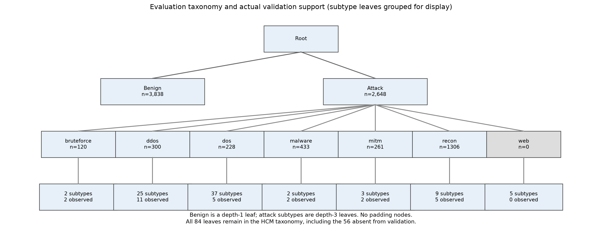
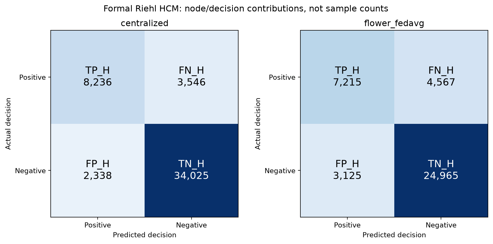
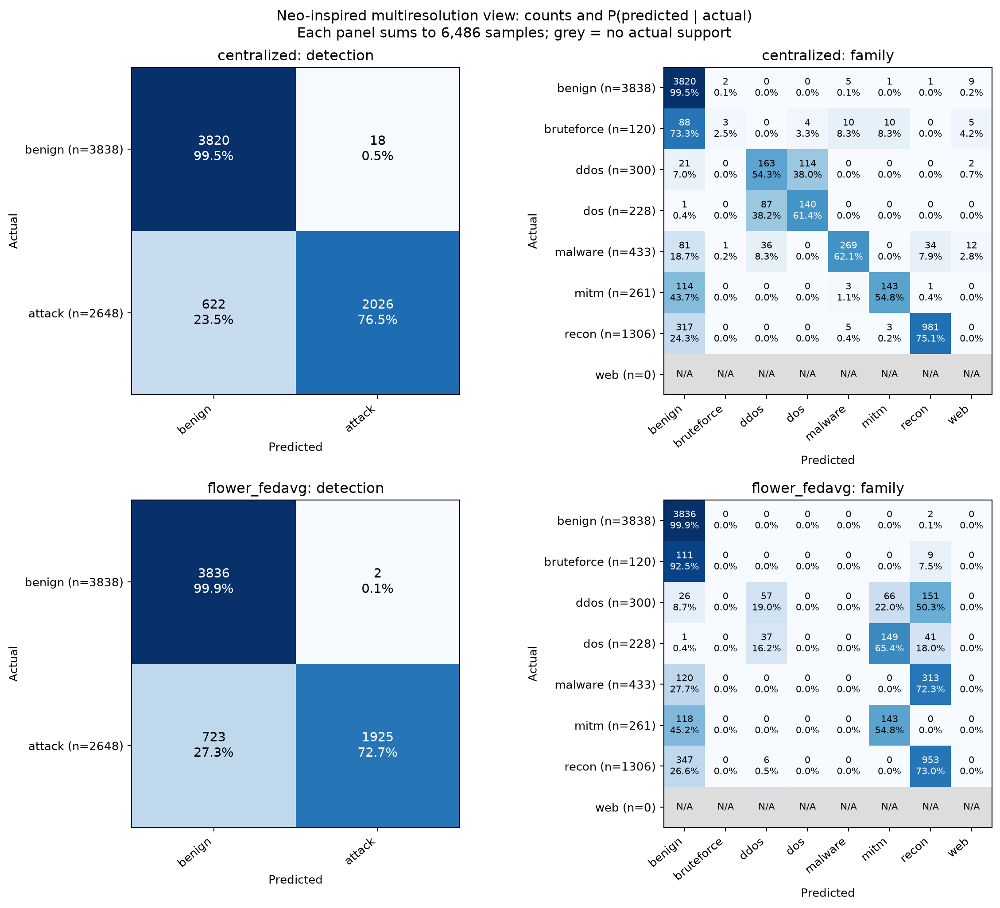
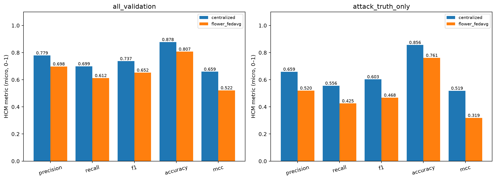

# Formal Riehl HCM — validation_v1

## Kapsam ve kaynaklar

Bu çalışma, mevcut 84 sınıflı Merkezi ve Flower FedAvg modellerinin kayıtlı 6.486 doğrulama tahminlerinin sonradan değerlendirmesidir. Eğitim ve model çıkarımı çalıştırılmadı. Yalnız `data/validation_v1/validation.csv` etiket/episode metadata'sı, kayıtlı tahminler ve eğitimden türetilmiş şema okundu. Korunan test kümeleri açılmadı.

Riehl, Neunteufel ve Hemberg (2023), *Hierarchical confusion matrix for classification performance evaluation*, JRSS Series C 72(5), 1394–1412, [DOI](https://doi.org/10.1093/jrsssc/qlad057), §4.1 Denklem (4) ve §4 Denklem (3). Yerelde makale yoktu; [yayıncı kaydı](https://academic.oup.com/jrsssc/article/72/5/1394/7217007), [arXiv ön baskısı](https://arxiv.org/abs/2306.09461) ve [yazar kodu](https://github.com/DerKevinRiehl/HierarchicalConfusionMatrix) incelendi. Kod commit'i: `2256f4c24b813ffb752a53e20a8092ec7b1e3ac3`. PDF, incelenen referans kodu, URL ve SHA-256 kayıtları `sources/` altında saklandı. Yayıncı HTML doğrudan indirmesi 403 verdi; doğrulanmış web kaydı ve arXiv PDF kullanıldı.

Görtler ve diğerleri (2022), *Neo: Generalizing Confusion Matrix Visualization to Hierarchical and Multi-Output Labels*, CHI ’22, [DOI](https://doi.org/10.1145/3491102.3501823), [arXiv v2](https://arxiv.org/abs/2110.12536v2), [Apple yayın kaydı](https://machinelearning.apple.com/research/generalizing-confusion-matrix). Neo, çok seviyeli matrislerin gösterimi ve normalizasyonu için dayanak alındı; Riehl'in TP/TN/FP/FN tanımlarının kaynağı değildir. Buradaki statik ve çevrimdışı görseller Neo'dan esinlenir; Neo sisteminin tam uygulaması oldukları iddia edilmez.

## Hiyerarşi ve varsayımlar

```text
Root
├── Benign (yaprak)
└── Attack
    └── 7 saldırı ailesi
        └── 83 saldırı alt türü (yapraklar)
```

Toplam 93 düğüm, 92 kenar ve 84 yaprak vardır. Problem ağaç / tek tahmin yolu / zorunlu yaprak tahminidir (T, SPL, MLNP). Benign yolu 1, saldırı yaprağı yolu 3 kenardır; benign için yapay aile/alt tür düğümü eklenmez. Kök TP sayılmaz. Tüm 84 eğitim sınıfı hiyerarşide tutulur; doğrulamada görülmeyen sınıflar budanmaz. DAG, çok etiketli ve iç düğümde duran tahminler bu uygulamanın kapsamı dışındadır.

## Matematiksel tanımlar

T gerçek kök→yaprak yolu, P tahmin yolu, C ortak en uzun başlangıç yolu, z bu ortak yolun son düğümü ve R kök olsun. N(v) kardeş düğümlerdir. Yazar koduyla uyumlu D₁(z) doğrudan çocuklar kümesidir. Her örnek için:

- TP_H = |(T ∩ P) \ {R}|
- FP_H = |P \ T|
- FN_H = |T \ P|
- TN_H = |(⋃[v∈C] N(v)) \ T| + |D₁(z) \ (T ∪ P)|

Denklem (3) uyarınca dört sayı örnekler üzerinden ayrı ayrı toplanır. Ana sonuçlar bu toplamların mikro ölçütleridir: precision=TP/(TP+FP), recall=TP/(TP+FN), F1=2TP/(2TP+FP+FN), accuracy=(TP+TN)/(TP+TN+FP+FN), specificity=TN/(TN+FP), FPR=FP/(FP+TN), FNR=FN/(TP+FN), MCC=(TP·TN−FP·FN)/√((TP+FP)(TP+FN)(TN+FP)(TN+FN)). Tanımsız paydalar JSON null / boş CSV hücresidir. Makale Tablo 2'de FNR'nin payında görünen FP yazım hatası taşınmadı; FN kullanılır.

**TN yorumunun sınırı:** Makale metni D için ‘descendants’ sözcüğünü kullanırken, sabitlenen yazar kodunun `getDescendants` fonksiyonu yalnız `graph.neighbors` (doğrudan çocuklar) döndürür; `getNeighbors` kardeşleri döndürür. Ana sonuç yazar kodu ve Şekil 4a'nın (3,5,0,0), (2,4,1,1), (1,2,2,2) örnekleriyle eşleşen bu operasyonel yorumu izler. Bütün geçişli alt düğümleri TN saymak aynı sayıları vermez. Belirsizlik gizlenmedi: sadece D₁ yerine geçişli D⁺ kullanan ayrı TN duyarlılık sonucu JSON'da saklandı; bu varyant ana Riehl referans sonucu değildir. TP/FP/FN ve precision/recall/F1 bu değişiklikten etkilenmez.

HCM 2×2 düzeni `[[TP_H,FN_H],[FP_H,TN_H]]`: satır gerçek karar, sütun tahmin edilen karar. Bunlar örnek sayısı değil, örneklerin düğüm/karar katkılarıdır. TP+TN+FP+FN toplamının 6.486 olması beklenmez; TP+FN tüm modellerde gerçek yol uzunlukları toplamı olan **3838 + 3×2648 = 11782** olmalıdır.

Mevcut beş ayrık örnek hata kategorisi ayrı bir teşhis özetidir ve formal HCM değildir. `*_legacy_categories_with_hcm.csv` bu ayrımı koruyarak kategori içindeki HCM katkılarını gösterir. Düz alt tür doğruluğu ve önceki sınıf Makro F1 de HCM ölçütleriyle değiştirilmedi.

## Sonuçlar

HCM sayımları ve mikro ölçütleri (0–1 ölçeği):

| Ölçüt | Merkezi | Flower FedAvg |
|---|---:|---:|
| TP_H | 8236 | 7215 |
| TN_H | 34025 | 24965 |
| FP_H | 2338 | 3125 |
| FN_H | 3546 | 4567 |
| HCM accuracy | 0.877785855229 | 0.807082664526 |
| HCM precision | 0.778891620957 | 0.697775628627 |
| HCM recall | 0.699032422339 | 0.612374809031 |
| HCM f1 | 0.736804437288 | 0.652291836181 |
| HCM specificity | 0.935703874818 | 0.888750444998 |
| HCM false_positive_rate | 0.064296125182 | 0.111249555002 |
| HCM false_negative_rate | 0.300967577661 | 0.387625190969 |
| HCM mcc | 0.659153656963 | 0.521704963906 |

Tam hassasiyetli sayılar `comparison.json` ve `comparison.csv` içinde. Yalnız gerçek saldırı örnekleri (n=2648) için ek tanı:

| HCM ölçütü | Merkezi | Flower FedAvg |
|---|---:|---:|
| precision | 0.659104477612 | 0.520006155740 |
| recall | 0.555891238671 | 0.425352467271 |
| f1 | 0.603113903305 | 0.467940728431 |

Bu saldırı alt kümesi, benign örneklerdeki yanlış alarmları içermez; tam doğrulama sonuçlarının yerine geçmez. HCM recall, düz saldırı tespit recall'u değildir. Kısa benign ve uzun saldırı yolları farklı pozitif karar sayısı üretir; yüksek aile dal sayıları TN'yi etkiler. HCM accuracy/specificity bu nedenle düz kayıt doğruluğu veya operasyonel yanlış alarm oranıyla eşanlamlı değildir.

## TN yorumuna duyarlılık

Aşağıdaki alternatif yalnız ortak yolun son düğümündeki D₁ kümesini geçişli D⁺ ile değiştirir; kardeşlik tanımı sabittir. Ana sonuç değildir. Bu farkın accuracy/MCC üzerindeki etkisi, TN yorumunun niçin açıkça sabitlendiğini gösterir.

| Model | Ana TN | Geçişli TN (duyarlılık) | Ana accuracy | Geçişli accuracy |
|---|---:|---:|---:|---:|
| centralized | 34025 | 116832 | 0.877785855229 | 0.955067505651 |
| flower_fedavg | 24965 | 151297 | 0.807082664526 | 0.953719525403 |

## El hesabı test örnekleri

Küçük test ağacında Root→Benign ve Root→Attack→{A,B} vardır; A'nın iki, B'nin üç alt türü bulunur. Sıra (TP,TN,FP,FN) olarak:

| Gerçek → tahmin | TP | TN | FP | FN |
|---|---:|---:|---:|---:|
| a1 → a1 | 3 | 3 | 0 | 0 |
| benign → benign | 1 | 1 | 0 | 0 |
| a1 → a2 (aynı aile) | 2 | 2 | 1 | 1 |
| a1 → b1 (farklı aile) | 1 | 1 | 2 | 2 |
| a1 → benign | 0 | 0 | 1 | 3 |
| benign → a1 | 0 | 0 | 3 | 1 |

Bu tablo gerçek deney sayıları değildir; formal tanımların birim testindeki el hesabıdır. Kaynak künyeleri ve erişim kayıtları: `sources/REFERENCES.md`, `sources/references.bib`, `sources/retrieval.json`.

## Görseller









[Alt tür matrisi](formal_hcm_v1/neo_grouped_subtypes.png): 28 gerçek sınıf × 84 tahmin sınıfı, aile sınırları gösterilir. [Çevrimdışı gezgin](formal_hcm_v1/confusion_explorer.html) model, seviye, gerçek aile filtresi ve normalizasyon seçer; dış ağa istek yapmaz. Her seviyedeki sayım matrisi aynı 6486 örneği toplar. Satır normalizasyonu P(tahmin|gerçek), toplam normalizasyon P(gerçek,tahmin) verir. Desteksiz web satırı N/A'dır; görsel olarak sıfır başarı gibi yorumlanmaz. Bütün statik şekiller PNG ve SVG'dir.

## Testler ve tutarlılık

El hesabına dayalı testler: tam saldırı tahmini, tam benign tahmini, doğru aile/yanlış alt tür, yanlış saldırı ailesi, saldırı→benign ve benign→saldırı. Ayrıca makalenin Şekil 4a örnekleri, TN'nin tüm off-path düğümler olmadığının kontrolü, metrik/tanımsız payda kontrolleri ve geçersiz hiyerarşi/tahmin reddi var. **84×84 = 7056 olası yaprak çifti** sabitlenen yazar koduyla birebir karşılaştırılır. Log: `unit_tests.log`.

Tahmin satırları, ID'ler, aile eşlemesi ve episode metadata'sı doğrulamayla hizalandı; eski alt tür doğruluğu ve beş kategori sayısı aynen yeniden üretildi. Aile matrisi alt tür matrisinden tekrar birleştirilerek kontrol edildi. Her örneğin HCM katkıları, bütün yaprak çifti tablosu, aile/alt tür destekleri ve metrikleri CSV'dedir. `validation_checks.json`, son `verification.json` ve SHA-256 manifesti sayısal/bütünlük kontrollerini kaydeder.

## Sınırlılıklar ve yorum

- Doğrulama yalnız 28/84 alt tür ve 7/8 aileyi kapsar; **56 sınıf ve web ailesi yoktur**. Tam hiyerarşinin TN hesabında tutulmaları, bu sınıfların test edildiği anlamına gelmez.
- Episode ID'leri sezgisel aday gruplardır; bağımsız oturum kanıtı değildir. Benign zamansal holdout'tur. Bağımsız oturum değerlendirmesi veya tam 84 sınıf kapsamı iddia edilmez.
- Tek tohumlu önceki modellerin sabit tahminleri kullanıldı. Yeni yerel modeller, tekrarlı tohumlar, sınıf dengesizliği müdahaleleri veya istatistiksel anlamlılık analizi yapılmadı.
- HCM kısmi doğru yolları ödüllendirir; benign çoğunluğu ve ağaç şekli toplamlara etki eder. TP/FP/FN/F1 ile birlikte düz saldırı recall'u, benign FPR ve sınıf raporlarını okumak gerekir. Bu sonuçlar doğrudan dağıtım güvenliği veya genellenebilir üstünlük kanıtı değildir.
- Ana TN yazar referansının doğrudan çocuk yorumudur; geçişli alt düğüm duyarlılığı ayrı raporlandı. Kapsam T/SPL/MLNP'dir; genelleştirilmiş DAG/çok etiket HCM testi yapılmadı.
- Flower sonuçları simülasyondan gelir. Bu görevde Raspberry Pi, Kali VM, canlı saldırı, trafik yakalama veya ağ ayarı çalıştırılmadı. Gelecek tasarım `docs/pi_kali_fl_testbed_design.md` içindedir.

## Yeniden üretim

```bash
/home/seniorfl/seniorproject-fl-venv/bin/python -m unittest discover -s tests -p 'test_formal_hcm.py' -v
/home/seniorfl/seniorproject-fl-venv/bin/python scripts/27_evaluate_formal_hcm_v1.py --mode verify
# Ayrı sonuç dizinine yeni değerlendirme (mevcut sonuçlar korunur):
/home/seniorfl/seniorproject-fl-venv/bin/python scripts/27_evaluate_formal_hcm_v1.py --output-dir results/formal_hcm_v1_repeat
```

Yeni değerlendirme yalnız kayıtlı girdileri okur; aynı hedefte önceki değerlendirmeyi ezmez. `--mode seal` son kaynak/belge arşivini ve manifesti bir kez oluşturur; `--mode verify` salt okunurdur. İndirilen kaynaklar, URL/commit/hash kaydı, tam bağımlılık dökümü ve çalıştırma yapılandırması sonuç dizinindedir. PROJECT_STATUS.md değişmeden önce yedeği alındı; diğer eski kaynak/veri/model/sonuçların hash'leri korunma manifestiyle denetlenir.
